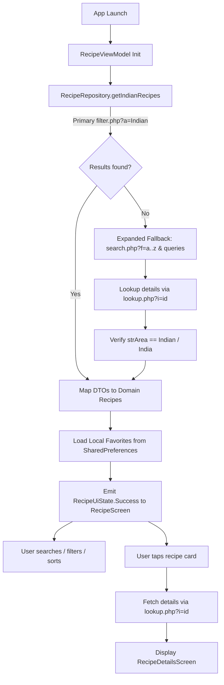

# TasteIndia — Indian Cuisine Discovery App

TasteIndia is a native Android application designed to help food enthusiasts and home cooks discover, search, filter, and explore authentic Indian cuisine. Built with modern Android development practices, it provides a polished experience for discovering regional Indian recipes, viewing detailed ingredients and step-by-step cooking instructions, managing favorites offline, and opening original recipe sources or cooking videos.

---

## 1. Project Title and Introduction

- **App Name**: TasteIndia
- **Summary**: An Indian Cuisine Discovery application built for Android enabling users to browse, search, filter, sort, view detailed recipes, manage local favorites, and access original recipe sources and cooking videos.
- **Problem Solved**: Addresses the challenge of discovering verified regional Indian recipes from public APIs by providing a clean, responsive UI with advanced search, category/ingredient filtering, offline favorite persistence, and robust fallback discovery mechanisms.

---

## 2. Features

- **Indian Recipe Browsing**: Browse a curated collection of authentic Indian recipes with high-resolution thumbnail images and recipe titles.
- **Recipe Details**: View comprehensive recipe information, including category, cuisine area, step-by-step cooking instructions, and clean ingredient-with-measurement lists.
- **Meal-Name Search**: Instantly search for recipes by typing in the search bar.
- **Category Filtering**: Filter recipes by culinary categories (e.g., Chicken, Vegetarian, Dessert) powered by TheMealDB API.
- **Main-Ingredient Filtering**: Filter recipes by key ingredients (e.g., Paneer, Dal, Lentils).
- **Favourites-Only Filtering**: Toggle to display only saved favorite recipes.
- **A–Z and Z–A Sorting**: Sort recipes alphabetically in ascending (A–Z) or descending (Z–A) order.
- **Combined Filters & Clear All**: Combine search, category, ingredient, and favorites filters seamlessly, view active result counts, and reset all filters instantly with **Clear All**.
- **Offline Favourites Persistence**: Tap the heart icon to favorite/unfavorite any recipe. Favourites are persisted locally using `SharedPreferences` so they survive app restarts and work offline.
- **Source & YouTube Links**: Access official recipe source websites and YouTube cooking videos directly from the recipe details screen via safe Android intents.
- **Robust State Handling**: Graceful loading indicators, meaningful empty states when no recipes match filters, and readable error states with a **Retry** action.

*(Limitation Note: Because TheMealDB's primary area filter endpoint (`filter.php?a=Indian`) returns `{"meals": null}` on the public educational tier, the app utilizes an expanded fallback discovery engine combining keyword searches and alphabetical index queries (`search.php?f=a..z`), strictly verified via details lookup (`lookup.php`) for `strArea == "Indian"` / `"India"`).*

---

## 3. Technology Stack & Android Toolchain Versions

- **Android Toolchain & SDK Versions**:
  - **Min SDK**: 24 (Android 7.0 Nougat)
  - **Compile SDK**: 37 (Android 15+)
  - **Target SDK**: 37 (Android 15+)
  - **Android Gradle Plugin (AGP)**: 9.4.1
  - **Kotlin Version**: 2.2.10
  - **Java Compatibility**: JavaVersion.VERSION_11
  - **Jetpack Compose BOM**: 2026.02.01
- **Networking**: **Retrofit (v2.11.0) & OkHttp (v4.12.0)** — Type-safe HTTP client with configured connection/read/write timeouts (15s) and logging interceptors.
- **JSON Serialization**: **Moshi (v1.15.2)** — Fast, lightweight JSON parsing with Kotlin adapter support and null-safe DTO mapping.
- **Concurrency**: **Kotlin Coroutines & Flow (`Dispatchers.IO`)** — Asynchronous off-main-thread network operations and immutable `StateFlow`.
- **Architecture Components**: **ViewModel & Lifecycle Compose (`v2.8.7`)** — UI state management surviving configuration changes with lifecycle-aware collection (`collectAsStateWithLifecycle()`).
- **Local Persistence**: **Android SharedPreferences** — Lightweight offline key-value storage for persisting favorite recipe IDs (`idMeal`).
- **Image Loading**: **Coil (v2.7.0)** — Asynchronous image loading with placeholder and error fallback support.
- **Testing**: **JUnit (v4.13.2) & Kotlinx Coroutines Test (v1.8.1)** — Unit testing framework and coroutine test dispatchers.

---

## 4. Architecture and Folder Structure

TasteIndia follows the **MVVM (Model-View-ViewModel)** architectural pattern with a clean separation of concerns, repository pattern, and unidiomatic unidirectional data flow (UDF).

```text
com.example.tasteindia/
├── data/
│   ├── remote/
│   │   ├── MealApiService.kt      # Retrofit API interface definitions
│   │   ├── MealDto.kt             # Moshi DTOs for meals, categories, and ingredients
│   │   └── NetworkModule.kt       # OkHttp client, timeouts, logging, and Retrofit instance
│   └── repository/
│       ├── FavoriteRepository.kt  # Local SharedPreferences persistence for favorite IDs
│       └── RecipeRepository.kt    # Single source of truth for recipes, categories, and fallback discovery
├── model/
│   ├── Recipe.kt                  # Domain model for recipe list items
│   └── RecipeDetail.kt            # Domain model for full recipe details
├── ui/
│   ├── components/
│   │   ├── RecipeDetailsScreen.kt # Full details view with ingredients, instructions, and links
│   │   ├── RecipeFilterBar.kt     # Search bar, category/ingredient chips, favorites switch, sort, clear
│   │   ├── RecipeItem.kt          # Reusable list card item with independent favorite button
│   │   └── RecipeScreen.kt        # Main screen hosting filter bar and recipe LazyColumn list
│   ├── theme/
│   │   ├── Color.kt               # Material 3 color palette
│   │   ├── Theme.kt               # Material 3 theme wrapper
│   │   └── Type.kt                # Typography definitions
│   └── viewmodel/
│       ├── RecipeUiState.kt       # Sealed interface for Loading, Success, Error states
│       └── RecipeViewModel.kt     # ViewModel managing filters, sorting, favorites, and UI state flows
└── MainActivity.kt                # Entry point hosting TasteIndiaTheme and RecipeScreen
```

---

## 5. Application Working Flow & Route Map

### Screen Navigation Route Map
Rather than a traditional multi-activity architecture or complex navigation graph library, TasteIndia uses a reactive **State-Based Screen Swapping Route Map** managed entirely within `RecipeViewModel`:
1. **Route 1 (`RecipeListScreen`)**: Active when `selectedRecipeId == null`. Displays the filter bar (`RecipeFilterBar`) and recipe list (`LazyColumn`).
2. **Route 2 (`RecipeDetailsScreen`)**: Active when `selectedRecipeId != null`. Displays full recipe details, hero image, ingredients, measurements, cooking instructions, and external web/video links. Back navigation (`TopAppBar` back arrow or system back) resets `selectedRecipeId = null`, returning to Route 1 while preserving all scroll position, search text, filters, and sort order.

### Application Working Flow
1. **App Launch**: `MainActivity` loads `RecipeScreen`, which initializes `RecipeViewModel` and loads local favorites via `FavoriteRepository`.
2. **Recipe Fetching**: `RecipeViewModel` requests recipes from `RecipeRepository`, which queries TheMealDB (`filter.php?a=Indian`) and falls back to expanded search discovery (`search.php`) if needed, validating cuisine via `lookup.php`.
3. **Displaying Recipe List**: Verified Indian recipes are mapped to `Recipe` models, combined with local favorite states, filtered, sorted, and emitted as `RecipeUiState.Success`.
4. **Search & Filter Processing**: User interactions update StateFlows in `RecipeViewModel`, applying pure filter/intersection logic.
5. **Selecting Recipe**: Tapping a recipe card invokes `viewModel.selectRecipe(idMeal)`, switching to Route 2 (`RecipeDetailsScreen`).
6. **Loading Recipe Details**: `RecipeRepository` calls `lookup.php?i={idMeal}` to retrieve full instructions, category, area, ingredients, measures, source URL, and YouTube URL.
7. **Managing Favourites**: Tapping the heart icon updates SharedPreferences instantly and updates UI state across all screens.
8. **External Links**: Tapping "View Original Recipe" or "Watch Cooking Video" validates and opens the URL using safe Android `Intent.ACTION_VIEW`.



---

## 6. API Integration & Endpoint Choices

- **Provider**: [TheMealDB API](https://www.themealdb.com/api.php) (Public V1 Educational Test API, key `1`).
- **Endpoint Choices & Roles**:
  - `filter.php?a=Indian`: Primary endpoint for fetching Indian cuisine recipes.
  - `search.php?s={query}` & `search.php?f={letter}`: Fallback discovery endpoints for robust recipe retrieval across keywords and the alphabet.
  - `lookup.php?i={id}`: Fetches complete recipe details, ingredients, measurements, area verification, source URL, and YouTube link.
  - `list.php?c=list`: Retrieves all available meal categories.
  - `list.php?i=list`: Retrieves all available meal ingredients.
  - `filter.php?c={category}` & `filter.php?i={ingredient}`: Fetches meal IDs for category and ingredient filtering.
- **Error Handling**: Network and HTTP errors are caught safely and mapped to `Result.failure`, displaying a readable error state with a retry action in the UI.

---

## 7. Filtering & Intersection Strategy

To guarantee that non-Indian recipes never enter the results during category or ingredient filtering, TasteIndia implements a strict **Authoritative Base Set Intersection Strategy**:
1. **Base Indian Set**: The application first resolves and caches the authoritative base set of verified Indian recipes (`baseRecipes`).
2. **Category / Ingredient Fetch**: When a category or ingredient filter is selected, the app queries TheMealDB (`filter.php?c={category}` or `filter.php?i={ingredient}`) to obtain candidate meal IDs.
3. **Set Intersection**: The resulting candidate IDs are strictly intersected with the base Indian recipe set IDs (`baseRecipes.map { it.idMeal }.toSet().intersect(filterMealIds)`).
4. **Search, Favorites, & Sorting**: Search text matching, favorites-only toggling, and A–Z / Z–A sorting are applied on top of the intersected collection in memory.

---

## 8. Caching Policy

- **Repository In-Memory Caching**: `RecipeRepository` caches verified recipes (`cachedRecipes`), categories (`cachedCategories`), ingredients (`cachedIngredients`), and category/ingredient meal ID sets (`categoryMealIdsCache`, `ingredientMealIdsCache`) in memory during the app lifecycle. This prevents redundant N+1 API calls and ensures instant filter responsiveness.
- **Network Timeouts & Interceptor**: OkHttp is configured with explicit 15-second connect, read, and write timeouts, accompanied by an `HttpLoggingInterceptor` for robust network observability.

---

## 9. Assumptions & Trade-Offs

- **API Test Key Restriction**: Assumed the educational test key `1` is used as specified by assignment instructions, working around TheMealDB's area filter limitations via expanded fallback search and details lookup.
- **State-Based Navigation vs. Navigation Library**: Traded off heavy navigation graph configuration for a lightweight, robust reactive state-based screen swapper (`selectedRecipeId`), which instantly preserves scroll position and filter state.
- **Local Persistence via SharedPreferences**: Chose `SharedPreferences` for local favorite ID storage as it provides synchronous, reliable, zero-migration offline key-value storage perfectly suited for a set of string IDs.

---

## 10. Known Issues & Limitations

- **Fallback Search Scope**: Because TheMealDB's primary area filter endpoint (`filter.php?a=Indian`) returns `{"meals": null}` on the public tier, the fallback search engine relies on configured keywords and alphabet queries (`search.php?f=a..z`). It discovers a rich collection of Indian recipes but does not index every unlisted recipe in the database.
- **Image Loading Fallback**: Relies on Coil's built-in caching; intermittent network drops may require tapping retry if thumbnail images fail to load.

---

## 11. Time Spent

- **Module 1 (Project Setup & API Integration)**: ~4 hours
- **Module 2 (Search, Filters & Sorting)**: ~3.5 hours
- **Module 3 (Recipe Details, Source & YouTube Links)**: ~2.5 hours
- **Module 4 (Local Persistence for Favourites)**: ~2 hours
- **Testing, Audit & Documentation**: ~2 hours
- **Total Estimated Time**: ~14 hours

---

## 12. Installation and Setup

### Prerequisites
- **JDK**: Java 11 or higher (configured via Gradle toolchain).
- **Android Gradle Plugin (AGP)**: v9.4.1.
- **Gradle**: Compatible wrapper included (`gradlew`).
- **Android SDK**: `compileSdk 37`, `targetSdk 37`, `minSdk 24` (Android 7.0+).

### Steps to Run
1. **Clone the Repository**:
   ```bash
   git clone https://github.com/NanthithaN/TasteIndia.git
   ```
2. **Open in Android Studio**:
   - Open Android Studio, select **Open**, and choose the cloned `TasteIndia` project folder.
3. **Sync Project**:
   - Allow Android Studio to import the project and sync Gradle dependencies automatically (or click **Sync Project with Gradle Files**).
4. **Build and Run**:
   - Connect an Android emulator or physical device (API 24+).
   - Click the green **Run** button (`Shift + F10`) in Android Studio.

*(Note: The project uses the official public educational API key `1` provided by TheMealDB. No private credentials or API keys need to be configured).*

---

## 13. Testing

The project includes unit tests covering data serialization, ingredient normalization, filter intersection, and sorting logic.

### Test Classes
1. **`RecipeRepositoryTest`**: Tests repository data fetching, fallback handling, and error scenarios using a mock `FakeMealApiService`.
2. **`RecipeFilterTest`**: Tests pure filter functions, search query matching, A–Z / Z–A sorting, favorites-only filtering, and category/ingredient intersection.
3. **`MealSerializationTest`**: Tests Moshi JSON parsing of representative TheMealDB responses and verifies ingredient-with-measurement normalization (`getIngredientsWithMeasurements()`).

### Running Tests
- **Via Android Studio**: Right-click the `src/test/java/com/example/tasteindia` directory and select **Run Tests**.
- **Via Command Line**:
  ```bash
  # Windows
  gradlew app:testDebugUnitTest

  # macOS / Linux
  ./gradlew app:testDebugUnitTest
  ```
- *(Note: All unit tests run entirely offline using coroutine test dispatchers and test fixtures without requiring internet connectivity).*

---

## 14. Attribution and Responsible AI Use

- **Attribution**: Recipe data, categories, ingredients, and images are provided by [TheMealDB API](https://www.themealdb.com/api.php).
- **Third-Party Libraries**: Jetpack Compose, Material 3, Retrofit, OkHttp, Moshi, Coil, Coroutines, and Lifecycle.
- **AI Assistance & Tool-Use Disclosure Template**:
  > *This project was developed with assistance from AI coding tools for architectural guidance, debugging network fallbacks, structuring unit tests, and drafting technical documentation. All implementation logic, architectural decisions, and testing suites were thoroughly reviewed, tested, and verified by the author.*
